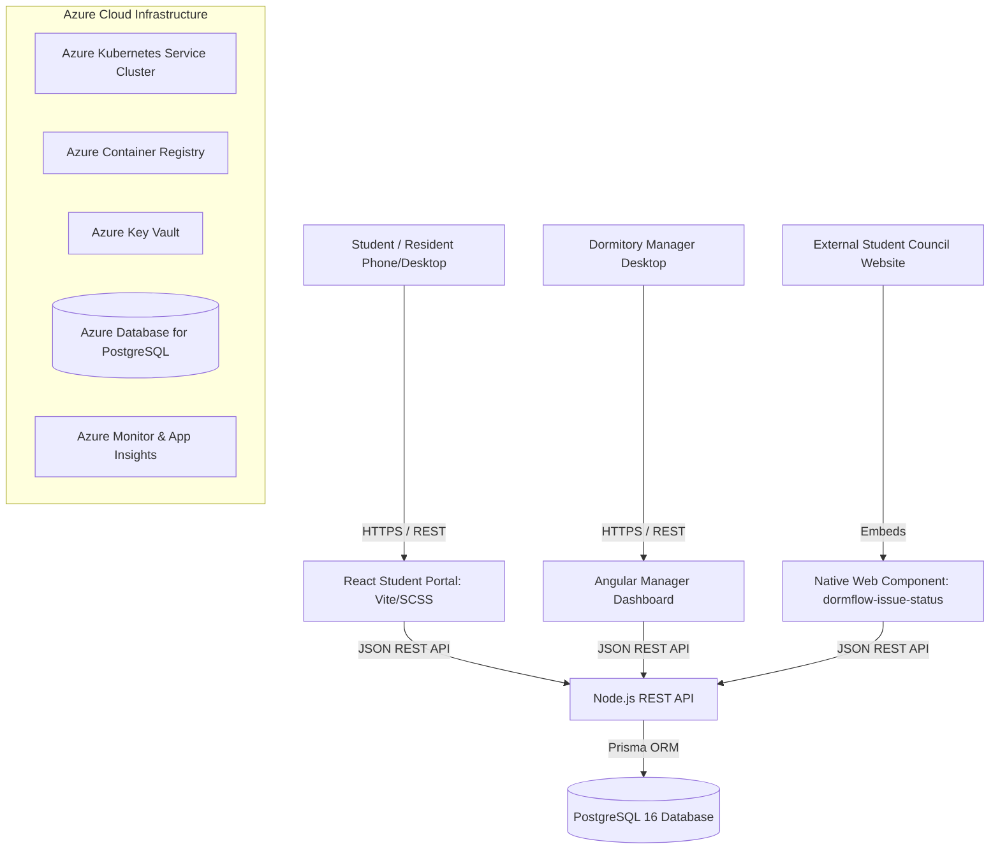
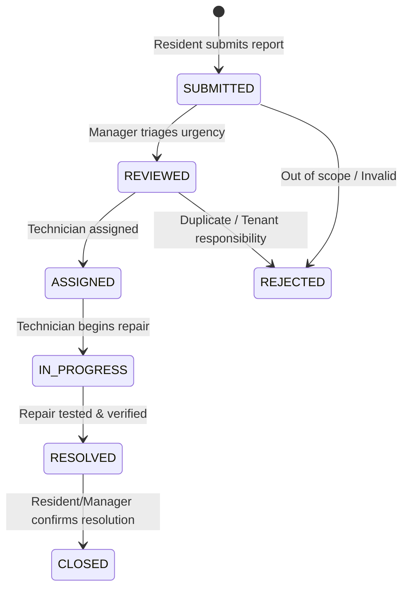

# DormFlow Aachen: System Architecture

## Architecture Overview

## Data Lifecycle & Status State Machine

## Security & Architecture Principles
1. **Zero Secret Leakage:** Environment variables and Kubernetes secrets keep database passwords and JWT signing keys out of Git.
2. **Server-Side Authorization:** While UI hides buttons, the Node.js API verifies `req.user.role` on all mutating endpoints (`PATCH /api/issues/:id/status`, `PATCH /api/issues/:id/assignment`).
3. **Structured Correlation:** Every request carries an `X-Correlation-Id` for log tracing across microservices.
